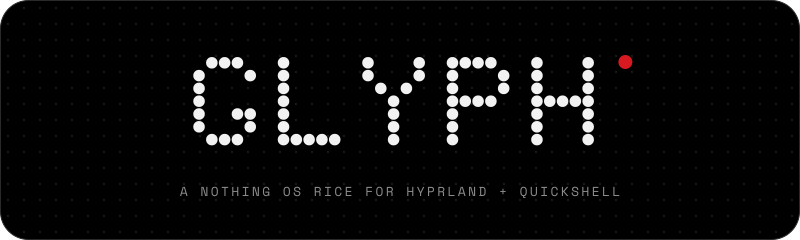
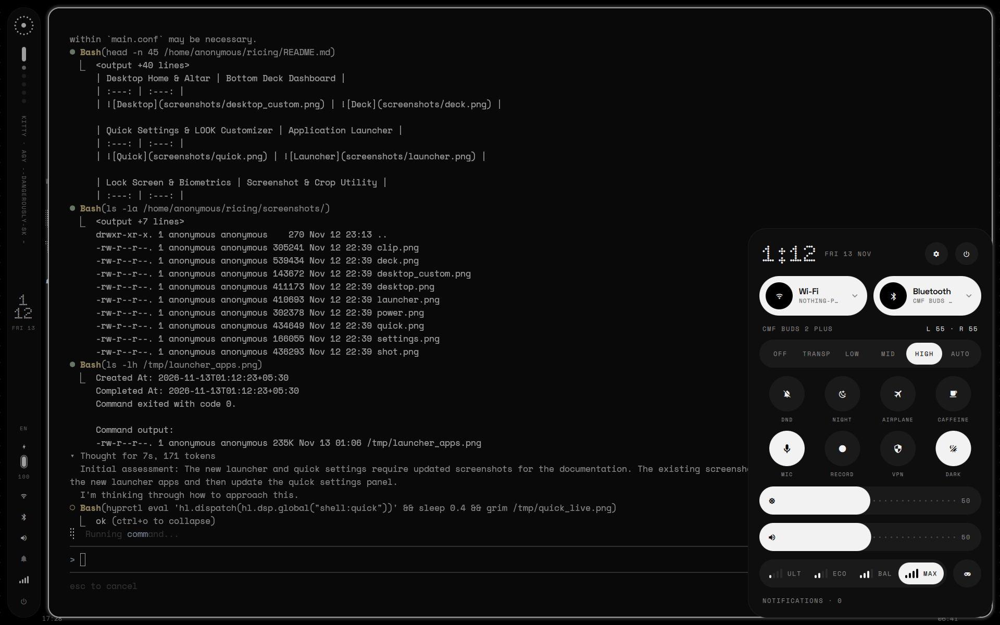
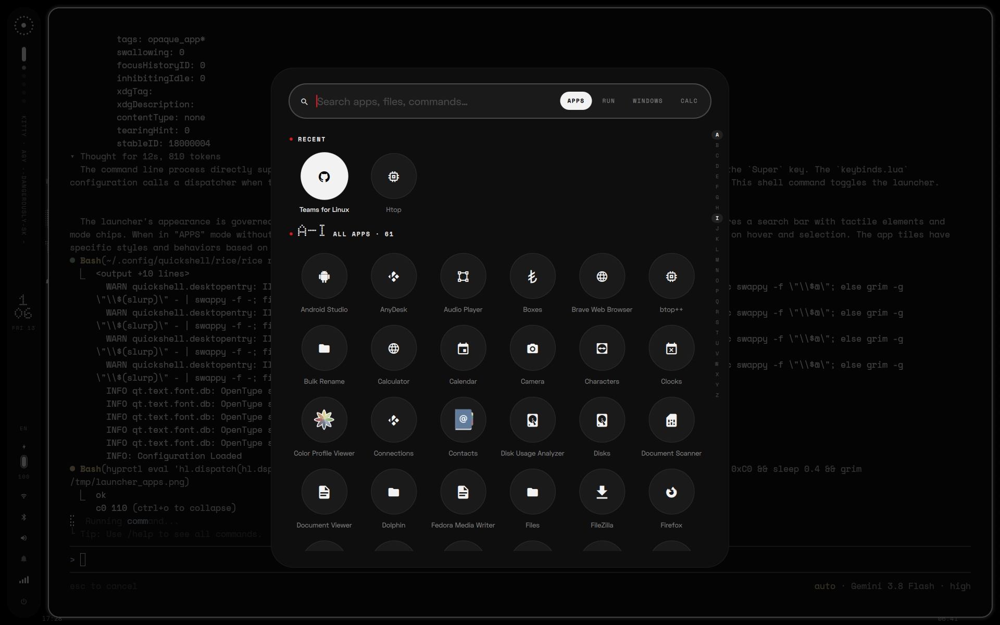
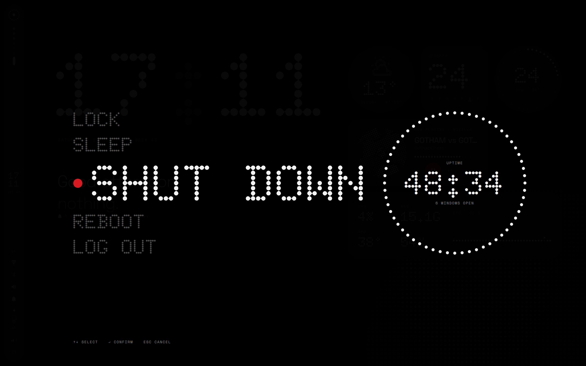
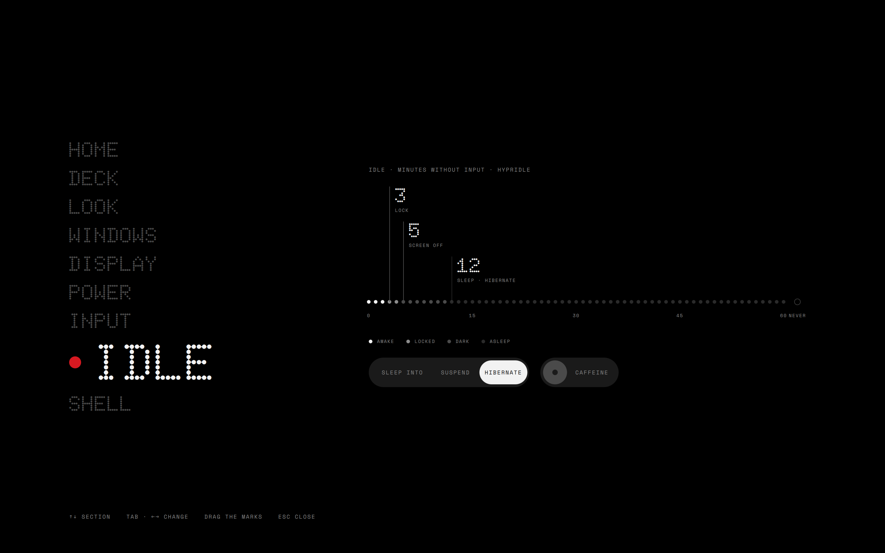
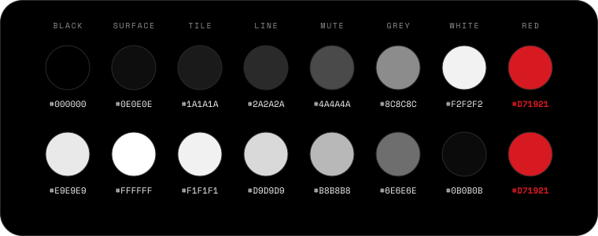

# ⬤ NOTHING OS GLYPH RICE FOR HYPRLAND

<div align="center">



<br/>


<br/>

[](#)
[](#)
[](#)
[](#)
[](#)
[](#)

*An ultra-minimal, high-density dot-matrix desktop environment inspired by Nothing OS. Powered by Hyprland (Lua configuration) and Quickshell (Qt 6.x SceneGraph), featuring real-time astronomical Swiss Ephemeris calculations, mathematically circular celestial geometry, zero-flicker atomic installer, and strict zero-allocation resource discipline.*

</div>

<br/>

<p align="center">
  
</p>

---

## 📸 Visual Showcase

<div align="center">

| Desktop Home & Altar | Bottom Deck Dashboard |
| :---: | :---: |
|  |  |

| Quick Settings & LOOK Customizer | Application Launcher |
| :---: | :---: |
|  |  |

| Lock Screen & Biometrics | Screenshot & Crop Utility |
| :---: | :---: |
|  |  |

| Clipboard History Manager | Preferences & Rules Engine |
| :---: | :---: |
|  |  |

</div>

<br/>

<p align="center">
  
</p>

---

## ✨ Features & Architecture

### 1. 🕒 High-Density Doto Clock with MagicUI Morphing Seconds
- **Space Grotesk & Dot-Matrix Halftone:** Digitally rendered through the Nothing OS SPIR-V dot shader (`Dm { step: 6.5 }`), creating circular monochrome LED dots (~24 vertical dots per digit).
- **MagicUI Liquid Morphing Physics:** Smooth cross-fade, organic scaling ($1.0 \leftrightarrow 0.88 / 1.10$), and micro-drift through the dot-matrix shader. Overlapping strokes organically melt and coalesce like liquid mercury.
- **Zero-Allocation GPU Architecture:** Direct vertex transforms without secondary Framebuffer Object (FBO) textures or multi-pass blur overhead.
- **Solid Colons:** Steady, non-blinking colons (`:`) eliminating background timer wakeups and repaints.

### 2. 🌙 Precision Astronomical Moon Orb & Lowered Telemetry
- **Astronomical Precision:** True 29.53-day synodic cycle calculated via UTC epoch and Swiss Ephemeris (`pyswisseph`).
- **Mathematically Circular Geometry:** Razor-sharp circular arc projection ($348\text{px} \times 347\text{px}$, 1.003 aspect ratio) bounded to `clip-path="url(#disk)"`.
- **Three-Layer Luminance Architecture:** Faint earthshine globe, razor-sharp sunlit phase (waxing/waning crescent, quarter, gibbous, full), and soft moonlight corona halo.
- **Serene Static Lunar Globe:** Wobble-free, zero-drift celestial centerpiece.
- **Lowered Telemetry Pill Badge:** Positioned with a clean 100px vertical margin beneath the globe rim, presenting real-time lunar stats in Nothing OS dot typography:
  ```text
  ● WAXING CRESCENT · 6.2% ILLUMINATED · MULA
  ```
- **Nothing Signature Red Accent:** Glowing spark dot (`#ff2e2e`) at the northern lunar crescent cusp.

### 3. ✨ Pure Nakshatra Constellation Projector
- **J2000 Astrometric Accuracy:** All 27 Vedic Nakshatras calculated with true astronomical right ascension, declination, and distance from Hipparcos and Yale Bright Star catalogs.
- **Celestial Tangent Projection:** Tangent plane projection (North Up, East Left) preserving true physical angles and distance ratios.
- **Spectral Star Colors & Visual Magnitudes:** True apparent magnitudes ($m_v$) drive dot sizing; spectral temperatures drive star hues (Betelgeuse/Antares red supergiant, Arcturus golden-orange, Spica blue-white).
- **Active Celestial Highlighting:** Automatically updates every minute to track the active Moon mansion in real time with Hindi and English names.

### 4. 🌅 Solar & Lunar Horizon Arc
- **Dynamic Daytime Sun Path:** Parabolic horizon arc tracking real-time local solar elevation from sunrise to sunset with smooth temperature gradients.
- **Atmospheric Solar Corona Glow:** Multi-stage radial corona fall-off ($r=30\text{px}$) providing warm radiance along the horizon.
- **Nighttime Moon Rise:** At sunset, the moon rises at the left horizon anchor and traverses the parabolic path until dawn, rendered with its actual active synodic lunar phase.

### 5. 💻 Full Hardware Adaptability (PC Desktop & Laptop)
The rice dynamically inspects hardware and optimizes features out of the box:
- **Battery & Power Management:** On laptops, displays live battery charge, charging indicators, and low-power alerts via UPower. On desktop PCs without batteries, the battery pill is automatically hidden with zero visual gaps or errors.
- **Display Brightness & Backlight:** On laptops, controls `/sys/class/backlight` via `brightnessctl` with on-screen display (OSD) sliders. On desktop monitors without kernel backlights, brightness controls are automatically suppressed.
- **Multi-Monitor Output:** Auto-detects internal panels (`eDP-1`, `eDP-2`) on laptops, and dynamically matches external displays (`DP-1`, `HDMI-A-1`) on desktop PCs.
- **Trackpad Gestures vs Mouse:** Multi-touch gestures on laptops; standard mouse window moving (`Super + LMB`), resizing (`Super + RMB`), and workspace scrolling (`Super + Wheel`) on desktops.

### 6. 🎨 House Rules Palette Engine
Seamlessly switch between 7 built-in themes in real time without restarting:



- **0 · Demon's Shot (Default):** Blood & bone — iconic Nothing OS Monochrome White with Crimson Red accents.
- **1 · Absinthe:** Toxic green & emerald fairy.
- **2 · Nightshade:** Poison bloom — deep violet and purple gradients.
- **3 · Holy Water:** Cold blessing — ice blue & crystal cyan.
- **4 · Rust:** Old iron & warm industrial amber.
- **5 · Gilded:** Altar gold & burnished brass.
- **6 · Ghost:** Pure minimalist monochromatic — 100% black, white, and silver.

### 7. 🪟 Horizontal Sliding Workspaces & Calibrated Gestures
- **Horizontal Slide Animation:** Modern 1:1 horizontal workspace navigation (`slide`).
- **Calibrated Trackpad Travel:** Workspace swipe distance calibrated to **250px natural travel** for effortless, fluid workspace flipping.
- **Ergonomic Keybindings:** Full keyboard navigation mapped cleanly to `Super` / `Alt`.

---

## ⚡ Verified Resource Footprint

Strictly engineered for peak efficiency and low memory overhead:

| Metric | Measured Value | Notes |
| :--- | :--- | :--- |
| **Quickshell System RAM (RSS)** | **~318 MB** (0.9% system RAM) | Zero memory leaks |
| **Quickshell GPU VRAM** | **~122 MiB** | On Intel Iris / NVIDIA GeForce |
| **Total Desktop System VRAM** | **~416 MiB** | Combined across Hyprland + Kitty + Quickshell (~5%) |
| **GPU Utilization** | **~1–4%** | Pure SceneGraph vertex & opacity transforms |
| **Idle CPU Usage** | **~0–3%** | Ambient updates only; quiescent when windows cover screen |

<br/>

<p align="center">
  
</p>

---

## 🚀 One-Command Universal Menu-Driven Installer

> [!IMPORTANT]
> **Universal, Non-Destructive & Zero-Risk:** The installer runs a **menu-driven wizard at every step** and is engineered to run on **any Linux distribution** (Arch, Fedora, Debian/Ubuntu, openSUSE, Void, Alpine, NixOS) and **any Hyprland setup**.
>
> A **complete pre-installation snapshot backup** is automatically saved to `~/.config/ricing-backups/` right after initial confirmation, allowing instant 1-command rollback anytime via `./restore.sh`.

### 1. Launch the Setup Wizard
Clone and run the installer from either **Bash** or **Fish**:
```bash
git clone https://github.com/vaishnosingh/ricing.git ~/ricing
cd ~/ricing

# Run from Bash:
./install.sh

# Or run from Fish:
./install.fish
```

### 2. What Happens Step-by-Step
```
┌─[ Initial Confirmation ]
│  Please verify before proceeding
└─────────────────────────────────────────────────────────────────
Are you sure you want to continue this ricing? [Y/n]: 
```
1. **Initial Confirmation:** Confirms your intention to install. Choosing `N` exits cleanly with zero changes made.
2. **Immediate Complete Snapshot Backup:** Backs up your entire current desktop setup (`~/.config/hypr`, `quickshell`, `waybar`, `rofi`, `kitty`, `fish`, etc.) into `~/.config/ricing-backups/backup-<timestamp>/`.
3. **Compositor Freeze (Zero Screen Flashes):** Automatically suspends Hyprland inotify watchers during file operations, preventing intermediate screen strobing.
4. **Step 1: Installation & Architecture Mode:**
   * **Full Standalone Rice:** Clean, complete Nothing OS desktop.
   * **Modular Coexistence Overlay:** Leaves your existing `hyprland.conf` or `hyprland.lua` 100% intact! Generates `glyph-overlay.conf` and adds a reversible `source` line so you get Nothing OS widgets and gestures without losing your custom window rules.
   * **Developer Symlink Mode:** Directly symlinks to the repository for live theme and code development.
5. **Step 2: Hardware Profile:** Confirms Laptop Profile (enables battery telemetry, low-power alerts, trackpad gestures) vs Desktop PC Profile (disables battery & backlight widgets cleanly; mouse focus).
6. **Step 3: Distribution Package Manager:** Installs packages via `pacman`/`yay` (Arch), `dnf`/Copr (Fedora), `apt` (Debian/Ubuntu), `zypper` (openSUSE), `xbps` (Void), or `apk` (Alpine).
7. **Step 4: Display Resolution & Scaling Safeguard:** Choose native 1.0x (100% native resolution for 1080p/1200p to prevent oversized apps), 1.25x (1440p), 1.5x, 2.0x (4K), auto, or custom scale.
8. **Step 5: Visual Styling & Theme:** Choose Color Palette (0–6), Window Rounding (0px sharp flat, 8px subtle, 14px soft), Window Gaps, Animated Stars, Grid, and Blur/Shadows.
9. **Step 6: Input Devices & Gestures:** Calibrate swipe distance (**250px natural travel**, 200px fast flip, 350px, custom), natural scrolling, tap-to-click, cursor theme, and cursor size.
10. **Step 7: Default Application Stack:** Scans your system and configures preferred Terminal (`kitty`), Browser (`brave-browser`), File Manager (`nautilus`), and Shell (`fish`).
11. **Step 8: Typography & Terminal Font:** Select Font Family (`JetBrains Mono Nerd Font`), and Font Size (`12.5pt` optimal legibility, `11.0pt`, `14.0pt`).
12. **Step 9: Astronomical Engine:** Sets up an isolated Python environment for Swiss Ephemeris (`pyswisseph`) bypassing PEP 668 restrictions. Choose lowered telemetry badge placement or compact centered badge.
13. **Step 10: User Identity & Clock:** Personalize greeting display name for Altar/Lockscreen and select 12-Hour AM/PM or 24-Hour military clock.
14. **Step 11: System Services:** Enable daily midnight Nakshatra calculation timer and GTK dark theme.
15. **Step 12: Atomic Single-Pass Deployment:** Applies all settings, reloads Hyprland once, restarts QuickShell, and displays the keybinding cheat sheet!

---

### 3. Automated & Non-Interactive CLI Options
For scripts or power users who prefer automated non-interactive execution:
| Command | Action |
| :--- | :--- |
| `./install.sh` | Launch interactive step-by-step TUI wizard (Default) |
| `./install.sh --quick` | Fast automated install with recommended defaults |
| `./install.sh --overlay` | Modular overlay mode (coexist with existing Hyprland setup) |
| `./install.sh --links` | Developer symlink mode (links directly to repo) |
| `./install.sh --backup-only` | Takes a complete snapshot of your current desktop and exits |
| `./install.sh --restore` (or `./restore.sh`) | Interactive rollback wizard to restore any previous backup |
| `./restore.sh <path_to_backup>` | Instantly restore a specific timestamped snapshot |

---

### 4. One-Command Instant Rollback
If you ever want to revert your desktop to the state it was in before installation:
```bash
cd ~/ricing
./restore.sh
```
This safely removes the ricing symlinks/overlays, restores your original files from the snapshot backup, reloads Hyprland, and restarts your previous desktop configuration without any manual intervention.

---

## ⌨️ Keybinding Reference Card

### Window Management & System
| Shortcut | Action |
| :--- | :--- |
| <kbd>Super</kbd> (tap) | Open Application Launcher (instant fuzzy search) |
| <kbd>Super</kbd> + <kbd>Space</kbd> | Toggle Bottom Altar Dashboard & Celestial Sphere |
| <kbd>Super</kbd> + <kbd>A</kbd> | Quick Settings Control Center (Wi-Fi, Bluetooth, Audio) |
| <kbd>Super</kbd> + <kbd>I</kbd> | Preferences & Appearance Customization Menu |
| <kbd>Super</kbd> + <kbd>Return</kbd> | Open Terminal (`kitty`) |
| <kbd>Super</kbd> + <kbd>B</kbd> | Open Web Browser (`brave-browser`) |
| <kbd>Super</kbd> + <kbd>E</kbd> | Open File Manager (`nautilus`) |
| <kbd>Super</kbd> + <kbd>Q</kbd> | Close Focused Window |
| <kbd>Super</kbd> + <kbd>V</kbd> | Clipboard History Manager (`cliphist`) |
| <kbd>Super</kbd> + <kbd>.</kbd> | Emoji & Unicode Symbols Palette |
| <kbd>Super</kbd> + <kbd>Shift</kbd> + <kbd>W</kbd> | Wallpaper Selector |
| <kbd>Print</kbd> | Fullscreen / Region Screenshot Utility (`grim` + `slurp`) |
| <kbd>Super</kbd> + <kbd>P</kbd> | System Power Menu & Lock Screen |

### Workspace & Window Navigation
| Shortcut | Action |
| :--- | :--- |
| <kbd>Super</kbd> + <kbd>←</kbd> / <kbd>→</kbd> | Switch to Previous / Next Workspace |
| <kbd>Super</kbd> + <kbd>1</kbd> ... <kbd>9</kbd> | Switch Directly to Workspace 1–9 |
| <kbd>Super</kbd> + <kbd>Shift</kbd> + <kbd>1</kbd> ... <kbd>9</kbd> | Move Active Window to Workspace 1–9 |
| <kbd>Alt</kbd> + <kbd>Tab</kbd> | Cycle Window Focus in Current Workspace |
| <kbd>Super</kbd> + <kbd>F</kbd> | Toggle Window Fullscreen |
| <kbd>Super</kbd> + <kbd>Shift</kbd> + <kbd>Space</kbd> | Toggle Window Floating State |

### 🖐️ Multi-Touch Trackpad Gestures (Laptops)
| Gesture | Action |
| :--- | :--- |
| **3-Finger Swipe ↔ (Left / Right)** | Fluid 1:1 Workspace Switching (**250px calibrated natural travel**) |
| **3-Finger Swipe ↑ (Up)** | Open Application Launcher |
| **3-Finger Swipe ↓ (Down)** | Toggle Altar Dashboard |
| **3-Finger Pinch In** | Open Terminal (`kitty`) |
| **3-Finger Pinch Out** | Open Web Browser (`brave-browser`) |
| **4-Finger Swipe ↑ (Up)** | Toggle Special Workspace |
| **4-Finger Swipe ↓ (Down)** | Close Focused Window |
| **4-Finger Pinch In** | Open File Manager (`nautilus`) |
| **4-Finger Pinch Out** | Open Preferences (`settings`) |
| **5-Finger Swipe ↓ (Down)** | Suspend System |

### 🖱️ Mouse Bindings (Desktop PC & Laptop)
| Mouse Action | Effect |
| :--- | :--- |
| <kbd>Super</kbd> + <kbd>Left Click (Drag)</kbd> | Move Floating Window |
| <kbd>Super</kbd> + <kbd>Right Click (Drag)</kbd> | Resize Floating Window |
| <kbd>Super</kbd> + <kbd>Scroll Wheel</kbd> | Switch Workspaces |

---

## 📦 Distribution Packages

<details>
<summary><b>Arch Linux / EndeavourOS / CachyOS</b></summary>

```bash
sudo pacman -Syu --needed \
    base-devel git curl jq python \
    hyprland hypridle hyprsunset hyprpicker xdg-desktop-portal-hyprland xdg-desktop-portal-gtk \
    sddm quickshell polkit-gnome gnome-keyring geoclue upower xdg-user-dirs \
    pipewire pipewire-pulse wireplumber networkmanager bluez bluez-utils power-profiles-daemon \
    brightnessctl playerctl wl-clipboard cliphist grim slurp swappy imagemagick \
    kitty fish starship fastfetch btop cava eza zoxide \
    nautilus thunar pavucontrol ttf-jetbrains-mono-nerd noto-fonts papirus-icon-theme

# AUR Packages
yay -S --needed qtengine darkly-bin bibata-cursor-theme-bin zen-browser-bin
```
</details>

<details>
<summary><b>Fedora Linux (40 / 41 / 42 / 44)</b></summary>

```bash
sudo dnf install -y \
    git curl jq python3 python3-pip python3-devel gcc gcc-c++ make \
    hyprland hypridle hyprsunset xdg-desktop-portal-hyprland xdg-desktop-portal-gtk \
    sddm gnome-keyring geoclue2 upower xdg-user-dirs \
    pipewire pipewire-pulseaudio wireplumber NetworkManager bluez power-profiles-daemon \
    brightnessctl playerctl wl-clipboard grim slurp swappy ImageMagick \
    kitty fish starship fastfetch btop cava eza zoxide \
    nautilus thunar pavucontrol libnotify google-noto-sans-fonts papirus-icon-theme adw-gtk3-theme

# QuickShell Copr
sudo dnf copr enable -y solopasha/hyprland
sudo dnf install -y quickshell
```
</details>

<details>
<summary><b>Debian 12 / Ubuntu 24.04+</b></summary>

```bash
sudo apt-get update && sudo apt-get install -y \
    git curl jq python3 python3-pip python3-venv python3-dev build-essential \
    hyprland xdg-desktop-portal-hyprland xdg-desktop-portal-gtk \
    sddm gnome-keyring geoclue-2.0 upower xdg-user-dirs \
    pipewire pipewire-pulse wireplumber network-manager bluez \
    brightnessctl playerctl wl-clipboard grim slurp swappy imagemagick \
    kitty fish nautilus thunar pavucontrol libnotify-bin fonts-noto-core papirus-icon-theme
```
</details>

<br/>

<p align="center">
  
</p>

---

## 📜 License

This project is licensed under the **GNU General Public License v3.0** — see the [LICENSE](LICENSE) file for full details.

<div align="center">

*Engineered with precision for Nothing OS enthusiasts and Hyprland purists.*

**[⬆ Back to Top](#-nothing-os-glyph-rice-for-hyprland)**

</div>
