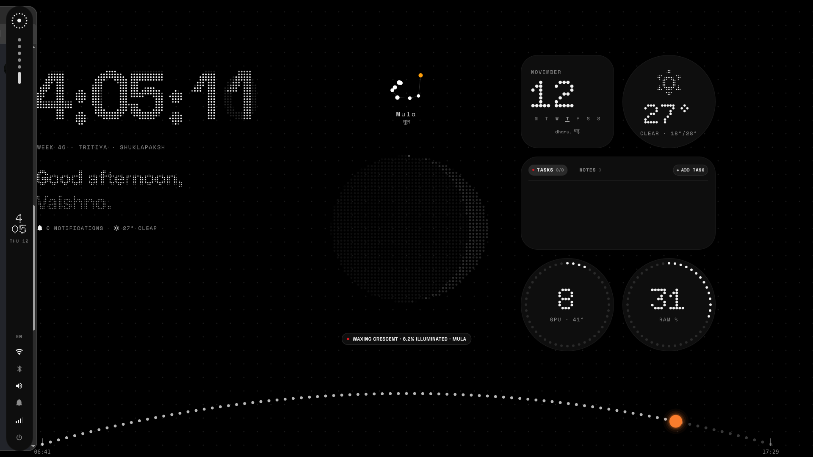
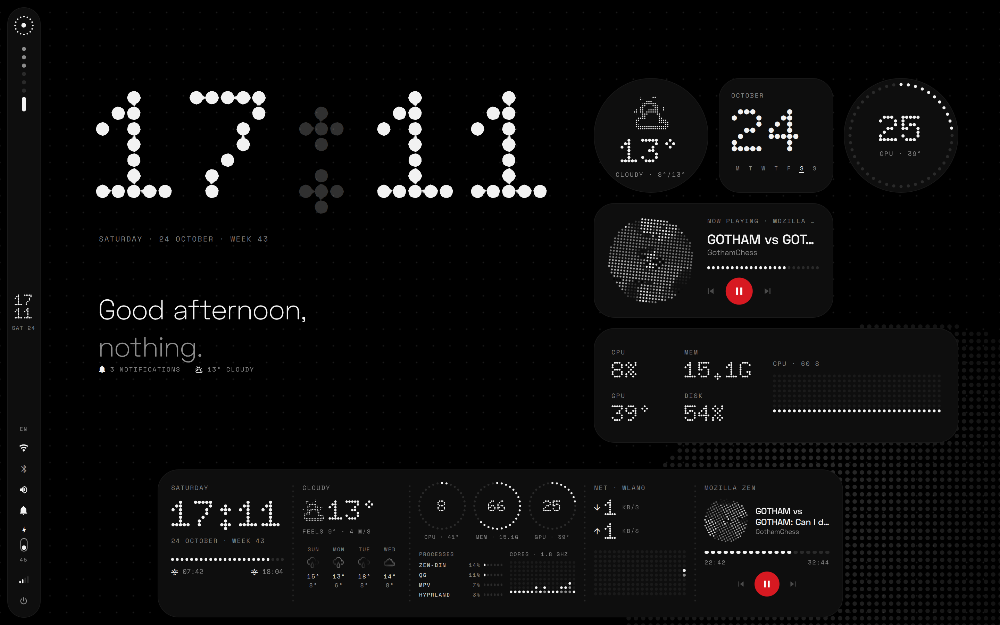
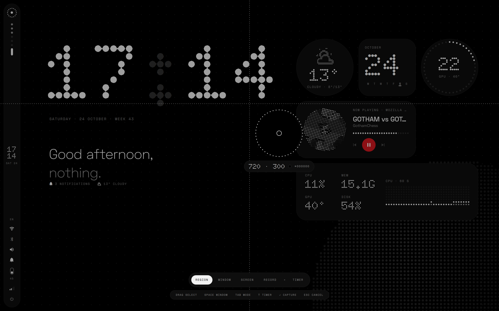

# ⬤ Nothing OS Glyph Rice for Hyprland

<div align="center">



[](#)
[](#)
[](#)
[](#)

*An ultra-minimal, high-density dot-matrix desktop environment inspired by Nothing OS. Powered by Hyprland (Lua configuration) and Quickshell (Qt 6.x SceneGraph), featuring real-time astronomical Swiss Ephemeris calculations, interactive celestial physics, and strict zero-allocation resource discipline.*

</div>

---

## ✨ Features at a Glance

### 1. 🕒 High-Density Clock with MagicUI Morphing Seconds
- **Space Grotesk & Dot-Matrix Halftone:** Digitally rendered through the Nothing OS SPIR-V dot shader (`Dm { step: 6.5 }`), creating circular monochrome LED dots (~24 vertical dots per digit).
- **MagicUI Liquid Morphing Physics:** Smooth cross-fade, organic scaling ($1.0 \leftrightarrow 0.88 / 1.10$), and micro-drift through the dot-matrix shader. Overlapping strokes organically melt and coalesce like liquid mercury.
- **Zero-Allocation GPU Architecture:** Direct vertex transforms without secondary Framebuffer Object (FBO) textures or multi-pass blur overhead.
- **Solid Colons:** Steady, non-blinking colons (`:`) eliminating background timer wakeups and repaints.

### 2. 🌙 Astronomical Moon Phase Orb & Interactive Gravity Well
- **Astronomical Precision:** True 29.53-day synodic cycle anchored to UTC epoch.
- **Three-Layer Luminance Architecture:** Faint earthshine globe, razor-sharp sunlit phase (waxing/waning crescent, quarter, gibbous, full), and soft moonlight corona halo.
- **Basaltic Lunar Maria:** High-contrast dark basalt plains (Sea of Tranquility, Oceanus Procellarum).
- **Interactive Cursor Gravity Well:** Moving your mouse near the moon orb organically attracts it ($\pm 14\text{px}$) with liquid spring damping physics (`spring: 2.8; damping: 0.28`) running at full native display refresh rate (144Hz).
- **Hover Telemetry Reveal:** Hovering over the orb smoothly reveals real-time astronomical stats in Nothing OS dot typography:
  `● WAXING CRESCENT · 6.2% ILLUMINATED · MULA`
- **Nothing Signature Red Accent:** Delicate red glowing spark dot (`#ff2e2e`) at the northern lunar crescent cusp.

### 3. ✨ Pure Nakshatra Constellation Projector
- **J2000 Astrometric Accuracy:** All 27 Vedic Nakshatras calculated with true astronomical right ascension, declination, and distance from Hipparcos and Yale Bright Star catalogs.
- **Celestial Tangent Projection:** Tangent plane projection (North Up, East Left) preserving true physical angles and distance ratios.
- **Spectral Star Colors & Visual Magnitudes:** True apparent magnitudes ($m_v$) drive dot sizing; spectral temperatures drive star hues (Betelgeuse/Antares red supergiant, Arcturus golden-orange, Spica blue-white).
- **Active Celestial Highlighting:** Automatically updates every minute to track the active Moon mansion in real time with Hindi and English names.

### 4. 🌅 Solar & Lunar Horizon Arc
- **Dynamic Daytime Sun Path:** Parabolic horizon arc tracking real-time local solar elevation from sunrise to sunset with smooth temperature gradients.
- **Atmospheric Solar Corona Glow:** Multi-stage radial corona fall-off ($r=30\text{px}$) providing warm radiance along the horizon.
- **Nighttime Moon Rise:** At sunset, the moon rises at the left horizon anchor and traverses the parabolic path until dawn, rendered with its actual active synodic lunar phase.

### 5. 🌠 GPU-Accelerated Shooting Stars & Grand Comets
- **Multi-Radiant Trajectories:** Northwest plunges ($32^\circ$ to $48^\circ$), Northeast counters ($132^\circ$ to $148^\circ$), high-altitude horizon gliders, and steep drops.
- **Grand Comets:** Majestic long-tail comets (360–480px) with ethereal ion dust auras and Nothing OS dot-matrix wake sparks.
- **Zero Idle Overhead:** 100% GPU hardware-accelerated SceneGraph transitions with zero CPU polling when idle. Toggleable in settings.

### 6. 📝 Interactive Notes & Tasks Bento Widget
- **Segmented Nothing OS Tabs:** Clean toggle between `[ • TASKS ]` and `[ • NOTES ]`.
- **Task Mode:** Inline task creation, tickbox toggles (Nothing red checkmark `✓` + strikethrough), task editing (`✎`), task deletion (`✕`), and clear completed.
- **Notes Mode:** Multi-note pagination (`‹ 1/N ›`), inline editing of note title and scrollable body, auto-saved to disk.
- **Persistent Storage:** Stored in `~/.local/state/rice/tasks.json` with reactive file watching.

### 7. 🪟 Horizontal Sliding Workspaces & Ergonomic Keybinds
- **Horizontal Slide Animation:** Modern horizontal workspace navigation (`slide`).
- **Ergonomic Keybindings:**
  - `Windows + Arrows`: Switch horizontal workspaces.
  - `Alt + Arrows`: Directional window focus navigation.
  - `Super + B`: Chromium default browser.
  - `Super + Enter`: Kitty terminal.
  - `Super + E`: Thunar file manager with custom Papirus-Dark / Bibata-Modern-Ice theme.
  - `Super + I`: Quick settings & rice appearance customization menu.
  - `Super`: Launcher with instant search.

---

## ⚡ Verified Resource Footprint

Strictly engineered for peak efficiency and low memory overhead:

| Metric | Measured Value | Notes |
| :--- | :--- | :--- |
| **Quickshell System RAM (RSS)** | **~318 MB** (0.9% system RAM) | Zero memory leaks |
| **Quickshell GPU VRAM** | **~122 MiB** | On NVIDIA GeForce RTX 5060 |
| **Total Desktop System VRAM** | **416 MiB / 8151 MiB** | Whole desktop across Hyprland + Kitty + Quickshell (~5%) |
| **GPU Utilization** | **~1–4%** | Pure SceneGraph vertex & opacity transforms |
| **Idle CPU Usage** | **~0–3%** | Ambient updates only; quiescent when windows cover screen |

---

## 📸 Screenshots

| Desktop Overview | Bottom Deck Dashboard |
| :---: | :---: |
|  |  |

| Quick Settings & LOOK Menu | Launcher |
| :---: | :---: |
|  |  |

| Lock Screen | Screenshot Utility |
| :---: | :---: |
|  |  |

---

## 🚀 Installation & Quickstart

### Prerequisites
- **OS:** Linux (Arch Linux, Pop!_OS, Ubuntu, Debian, Fedora, NixOS)
- **Compositor:** Hyprland 0.57+
- **Shell UI:** Quickshell (Qt 6.x)
- **Terminal:** Kitty
- **Shell:** Fish
- **Python:** Python 3.10+ with `pyswisseph` (for Swiss Ephemeris astronomical calculations)

### Automated Install (Arch Linux)
```bash
git clone https://github.com/vaishnosingh/ricing.git ~/.local/share/glyph
cd ~/.local/share/glyph
./install.sh
```

### Symlinks Only (Pop!_OS / Ubuntu / Debian / Fedora)
If you already have your base packages and window manager installed:
```bash
git clone https://github.com/vaishnosingh/ricing.git ~/.local/share/glyph
cd ~/.local/share/glyph
./install.sh --links
```

### Enable Astronomical Ephemeris Service
The astronomical engine computes real-time Nakshatra and Tithi coordinates:
```bash
systemctl --user daemon-reload
systemctl --user enable --now nakshatra-calc.timer
```

---

## ⌨️ Essential Keybindings

| Keybinding | Action |
| :--- | :--- |
| `Super` (tap) | Open Application Launcher |
| `Super + Enter` | Open Kitty Terminal |
| `Super + B` | Open Default Browser (Chromium) |
| `Super + E` | Open Thunar File Manager |
| `Super + I` | Open Settings & LOOK Customization |
| `Super + Space` | Toggle Bottom Deck Dashboard |
| `Super + N` | Toggle Quick Settings Panel |
| `Super + V` | Open Clipboard History |
| `Super + Shift + S` | Open Region Screenshot Tool |
| `Super + Shift + W` | Open Dot-Matrix Wallpaper Selector |
| `Super + Left / Right` | Navigate Workspaces (Horizontal slide) |
| `Super + Scroll Up / Down` | Navigate Workspaces sequentially |
| `Alt + Arrows` | Move window focus directionally |
| `Super + Q` | Close Active Window |

---

## 📂 Repository Layout

```
ricing/
├── assets/                     # Wallpaper patterns and SVG dot-matrix masks
├── config/
│   ├── fish/                   # Fish shell config & custom greeting
│   ├── fonts/                  # Nothing OS Doto and glyph fonts
│   ├── hypr/                   # Hyprland 0.57+ Lua configs (keybinds, animations, rules)
│   ├── kitty/                  # Kitty terminal configuration & color palettes
│   ├── qtengine/               # Qt application engine styling
│   └── quickshell/
│       ├── glyph/              # Complete Quickshell Nothing OS environment
│       │   ├── components/     # Reusable components (Orb, MorphingDigit, Dm shader)
│       │   ├── home/           # Desktop screen (Home.qml, Back.qml, ShootingStars.qml)
│       │   ├── bar/            # Vertical pill bar with workspaces & tray
│       │   ├── lock/           # Lock screen surface
│       │   ├── deck/           # Bottom dashboard
│       │   ├── launcher/       # Application & window launcher
│       │   ├── quick/          # Quick settings panel
│       │   ├── prefs/          # Settings & visual customization menu
│       │   └── Theme.qml       # Global theme singleton & state
│       └── rice/               # Rice shell switcher
├── nakshatra-calc              # Python Swiss Ephemeris astronomical backend
├── systemd/                    # Systemd user timer & service units
├── state/                      # Initial persistent rice configuration JSONs
├── screenshots/                # Visual gallery assets
├── install.sh                  # Comprehensive setup & symlinking script
├── SETUP.md                    # Deep-dive architecture manual & history
└── README.md                   # This documentation
```

---

## 📜 Credits & Acknowledgments
- Inspired by the iconic industrial design of **Nothing OS** / Teenage Engineering.
- Built on top of the foundation created by [yasakei/glyph-rice](https://github.com/yasakei/glyph-rice).
- Powered by [Hyprland](https://hyprland.org/) and [Quickshell](https://quickshell.outfoxxed.me/).
- Astronomical ephemeris calculations via [Swiss Ephemeris (pyswisseph)](https://www.astro.com/swisseph/).

---

<div align="center">
Crafted with precision by <b>Vaishno Singh</b>
</div>
